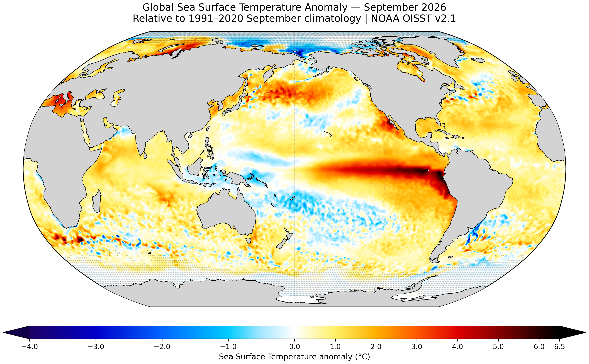

# Global Sea Surface Temperature Anomaly — September 2026

Interactive visualization of global sea surface temperature (SST) anomalies during **September 2026**, relative to the **1991–2020 September climatology**, using **NOAA OISST v2.1** data at 0.25° spatial resolution.

🌍 **Interactive project:**  
https://margranyena.github.io/global-sst-anomaly-3d/

---

## Overview

This project explores the spatial distribution of global sea surface temperature anomalies during September 2026.

The anomaly at each ocean grid cell is calculated as

\[
\Delta SST = SST_{Sep\,2026} - SST_{clim,\,1991-2020}
\]

where the climatological reference corresponds to the mean September SST during 1991–2020.

The resulting field is displayed using both a global 2D map and an interactive 3D globe.

---

## Global SST anomaly map



The map uses a Robinson projection and a colour scale centred at 0 °C.

The displayed colour range extends from **−4 °C to +6.5 °C**, while the original numerical values are preserved in the processed dataset.

---

## Interactive 3D globe

The interactive visualization allows the user to:

- rotate the Earth,
- zoom in and out,
- explore the full global anomaly field,
- hover over ocean regions to inspect local SST anomalies.

The globe preserves the original **0.25° NOAA OISST grid**.

👉 **Open the interactive visualization:**  
https://margranyena.github.io/global-sst-anomaly-3d/

---

## Data

**Dataset:** NOAA Optimum Interpolation Sea Surface Temperature (OISST) v2.1

**Target period:** September 2026

**Reference climatology:** September 1991–2020

**Spatial resolution:** 0.25° × 0.25°

**Global grid:** 720 × 1440 cells

The September 2026 SST field and the corresponding NOAA monthly climatology are accessed through NOAA PSL.

---

## Sea-ice treatment

Polar regions affected by sea ice were identified using NOAA sea-ice concentration.

A grid cell is considered sea-ice influenced when sea-ice concentration reaches at least **15%** either:

- during September 2026, or
- in the 1991–2020 September climatology.

These regions are indicated using stippling in the 2D visualization.

---

## Global mean anomaly

The area-weighted global mean anomaly is calculated using latitude-dependent weights:

\[
w(\phi)=\cos(\phi)
\]

For September 2026:

**Global mean SST anomaly: +0.75 °C**

---

## Workflow

The project is fully reproducible from the Python scripts included in the repository:

```text
scripts/
├── 01_descarrega_dades.py
├── 02_calcula_anomalia.py
├── 03_mapa_anomalia.py
└── 04_globus_3d.py